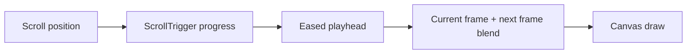

<p align="center">
  
</p>

<p align="center">
  <a href="https://rudrarealestate.vercel.app"></a>
  
  
  
</p>

<p align="center"><b>Find the right property in Noida.</b><br>Marketing site for <b>Rudra Real Estate</b>. Buy, sell, rent and invest with local experts, clear costs and complete paperwork support.</p>

<p align="center"></p>

## Preview

<p align="center">
  
  <br><sub>The scroll story: a building assembles piece by piece as you scroll. Real frames from the site, played in a loop.</sub>
</p>

## What is in the site

| Section | What it does |
| --- | --- |
| **Hero** | Headline, Call Now and WhatsApp buttons, and a navy and yellow building that follows the cursor on desktop. |
| **Problem** | Three lines of what goes wrong in property deals, answered by one line of what Rudra does. |
| **Scroll story** | A pinned canvas plays a 66-frame image sequence while five captions walk through a deal, from first consultation to keys in hand. |
| **Inside every deal** | A second pinned sequence (54 frames) covering verified listings, rentals and investments. |
| **Services** | Buying, selling, rentals and investment cards. Each has a WhatsApp enquiry link with a pre-filled message. |
| **Why Rudra** | Four values and four business stats. |
| **Contact** | Call, WhatsApp, address and email. |

<p align="center"></p>

## How the scroll engine works



- The playhead eases toward the scroll position, and two neighbouring frames are cross-blended, so playback stays smooth even with a limited frame count.
- Only the hero frame loads first. The remaining frames load in idle-time batches.
- If you scroll faster than frames load, the nearest loaded frame is shown instead of a blank canvas.
- On phones the whole building is framed in view instead of cropped, and a lighter frame set is used.

## Performance

| | Desktop | Phone |
| --- | --- | --- |
| Scroll story frames | 66 at 1920px, 1.5 MB | 33 at 960px, 0.25 MB |
| Inside frames | 54 at 1920px, 2.2 MB | 27 at 960px, 0.4 MB |
| GSAP + ScrollTrigger | 115 KB, served from this site | same |
| Inter (variable font) | 48 KB, served from this site | same |

- No third-party requests at runtime. GSAP and Inter are self-hosted.
- The hero image is preloaded and fades in. Fonts use `font-display: swap`.
- Data-saver and slow connections get the phone frame set. With reduced motion on, only two still frames are fetched.
- File sizes above are measured from the repo. Run Lighthouse on the deployed URL for real-world scores.

<p align="center"></p>

## Project structure

```text
index.html
css/styles.css          design tokens, layout, components
js/main.js              frame sequences, loading, header, menu, scroll story
js/dynamics.js          cursor, hero parallax, magnetic buttons, marquee, count-up
js/config.js            client-editable content: RERA number, stats, photos
js/site.js              renders that content
js/enquiry.js           lead form behaviour
js/vendor/              GSAP 3.12.5 and ScrollTrigger (self-hosted)
api/lead.js             lead form endpoint (Vercel function)
scripts/                photo optimiser
assets/fonts/           Inter variable, latin subset
assets/images/          logo
assets/sequence/        frames/ and bridges/ (desktop), mobile/ (phones)
assets/readme/          README banner, divider and preview
favicon.png
vercel.json             caching and security headers
```

## Run locally

```bash
python3 -m http.server 3000
```

Open http://localhost:3000. Use a local server rather than opening `index.html` from disk, so the frame images load.

## Deploy to Vercel

1. Import this repository at [vercel.com/new](https://vercel.com/new).
2. Framework preset: **Other**. Leave the build command and output directory empty.
3. Deploy. Every push to `main` redeploys.

CLI: `npx vercel --prod`.

## Design system

| Token | Value |
| --- | --- |
| Background | `#06111f` |
| Surface | `#0f1b2d` |
| Accent | `#facc15`, hover `#f59e0b` |
| Muted text | `#a3abb8` |
| Type | Instrument Serif for headlines (regular and italic), Inter 400 to 800 for body and UI. Both self-hosted. |
| Radius | 16px for controls and cards, pills for tags |
| Contact green | `#22c55e` (WhatsApp only) |

Yellow is reserved for the main actions and highlights.

## Dynamic text

- The hero headline rotates its key word (property, home, plot, office, investment, rental) with a slide-up mask. Screen readers get the static line "Find the right property in Noida."
- The statement under the problem section lights up word by word as you scroll.
- Stats count up, section headings reveal word by word, and a light sweep crosses "Noida."

## Accessibility and motion

- Respects `prefers-reduced-motion`: no pinned sequence, a static story and a single hero frame.
- The native cursor is never hidden. The custom ring only adds to it.
- Keyboard focus is visible everywhere. The menu locks the page behind it and returns focus when closed.
- Animated headings keep a proper label for screen readers.
- Touch devices get no cursor, tilt or magnetic effects.

## Client content (no code changes needed)

Edit **`js/config.js`**:

| Setting | What it does |
| --- | --- |
| `rera` | RERA registration number. Empty hides it; filled, it shows under the stats and in the footer. |
| `stats` | `null` keeps the current figures. Provide verified figures to replace them. |
| `photos` | Project photos. With 3 or more, a "Projects" gallery appears automatically. Prepare files with `python3 scripts/optimize-photos.py path/to/originals`. See `assets/photos/README.md`. |

## Lead form

The enquiry form posts to `api/lead.js` (a Vercel function). Set these in **Vercel > Settings > Environment Variables**, then redeploy:

| Variable | Purpose |
| --- | --- |
| `RESEND_API_KEY` and `LEAD_TO_EMAIL` | Emails each lead through [Resend](https://resend.com). `LEAD_TO_EMAIL` can hold several addresses, comma-separated. |
| `LEAD_FROM` | Optional sender, for example `Rudra Leads <leads@yourdomain.com>`. Needs a verified domain in Resend. |
| `LEAD_WEBHOOK_URL` | Optional. Also posts each lead as JSON (Google Sheets script, Zapier, etc.). |

If nothing is configured, or sending fails, the visitor gets a "Continue on WhatsApp" link with their details pre-filled, so no lead is lost. The form has a hidden spam field, checks the request origin and validates input on the server. It does not rate-limit; add that (for example with Vercel Firewall) if spam appears.

## Before launch

- [ ] Fill in `js/config.js`: verified stats, RERA number, project photos
- [ ] Set the lead form environment variables and send a test enquiry
- [ ] Use a professional email address instead of a personal one
- [ ] Add the production domain, canonical URL and an `og:image` with an absolute URL
- [ ] Add Privacy and Terms pages and analytics
- [ ] Add `sitemap.xml`, `robots.txt` and redirects for the old `/about` and `/services` URLs

<p align="center"></p>

<p align="center"><sub>Rudra Real Estate. Commercial - 01, First Floor, Shop No. 19, Paras Tierea, Sector 137, Noida.</sub></p>
